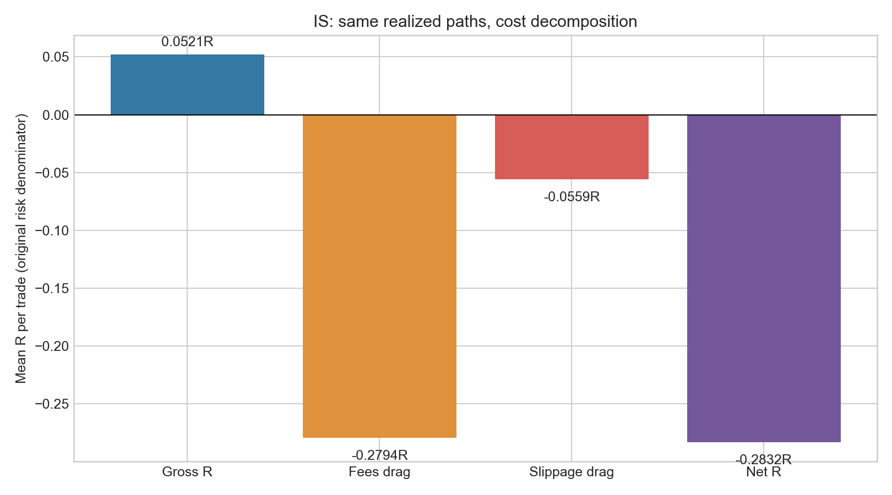
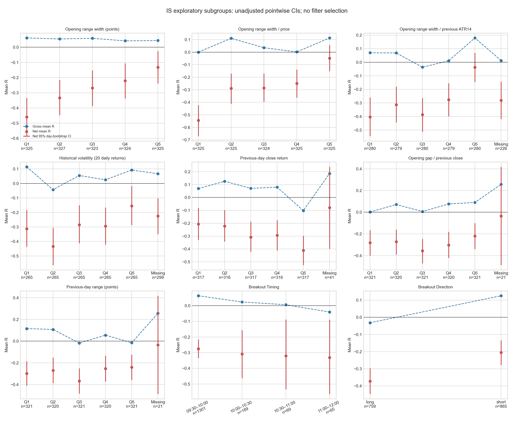
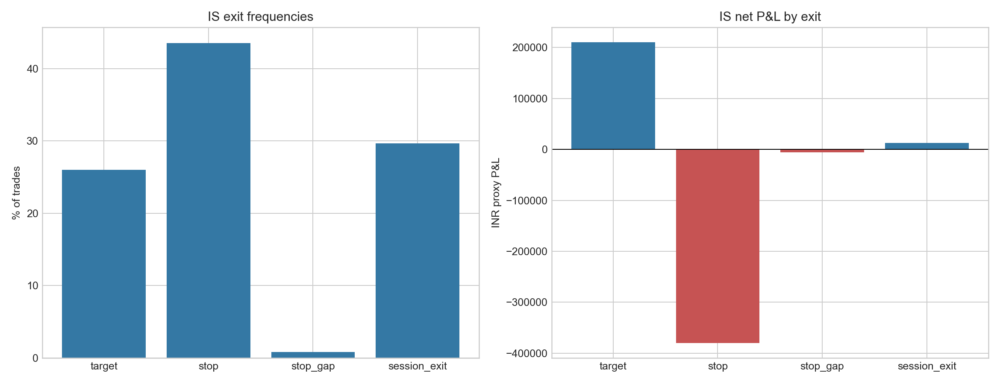
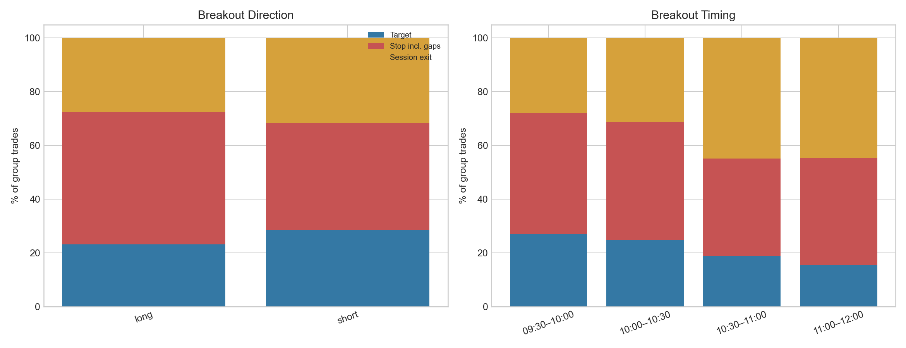

# ORB V1: IS-only diagnostic analysis

Scope: 1,624 original executed IS trades (2015–2021). No OOS outcomes/files were inspected. No rules, data exclusions, parameters, fills, or existing result files were changed; no model was fitted and no filters were selected.

## Reconstruction and reconciliation

Gross points = direction × (exit reference price − entry reference open). Entry slippage = direction × (entry adverse fill − entry reference open); exit slippage = direction × (exit reference price − exit adverse fill). Fees are calculated separately on each original adverse fill at the recorded per-side bps. Net points = gross points − both slippage components − both fees. Multiply by the original units for INR proxy P&L.
Original position sizing, adverse-fill entry-to-stop risk denominator, target level, realized entry/exit bars and exit categories are held fixed. Gross R uses that same original risk denominator. Therefore gross target R can exceed 1.5R after entry slippage is removed. This removes friction consistently from realized prices; it is NOT a rerun of a hypothetical frictionless strategy with changed target/stop paths or changed units. Gross profit factor is primarily reported in currency under original sizing, with points profit factor also provided.
Recorded config: `{"capital": 1000000, "cost_bps": 5, "notional_fraction": 0.1, "slippage_bps": 1, "target_r": 1.5}`. All reconstructed per-trade points, R, currency P&L, fees, and slippage match the IS ledger (rtol 1e-10; atol 1e-8). Total net P&L reconciles to INR -162,720.78697546, versus existing metric INR -162,720.78697546.

| basis | mean_points | mean_R | std_R | SE_R | CI95_low_R | CI95_high_R | profit_factor_currency | profit_factor_points | win_rate_pct | total_PnL_INR |
|---|---|---|---|---|---|---|---|---|---|---|
| Gross | 1.640582 | 0.052116 | 1.066767 | 0.026471 | 0.001480 | 0.104319 | 1.097768 | 1.074945 | 45.935961 | 32139.100470 |
| Net | -11.315056 | -0.283201 | 1.077054 | 0.026727 | -0.335527 | -0.229230 | 0.629527 | 0.613696 | 40.578818 | -162720.786975 |

| component | mean_points | mean_R | mean_INR | total_INR |
|---|---|---|---|---|
| entry_fee | 5.398981 | 0.139735 | 50.000000 | 81200.000000 |
| exit_fee | 5.397385 | 0.139696 | 49.989679 | 81183.239270 |
| entry_slippage | 1.079802 | 0.027947 | 10.000065 | 16240.106162 |
| exit_slippage | 1.079471 | 0.027939 | 9.997871 | 16236.542013 |

Total transaction fees: INR 162,383.239270; total adverse slippage: INR 32,476.648175; combined: INR 194,859.887445. Average combined entry cost (fee + slippage): 6.478783 points / INR 60.000065; average combined exit cost: 6.476856 points / INR 59.987550.
Costs equal 53.9976% of gross trading profits, defined as the sum of positive gross INR trades (INR 360,867.371249). As a separate denominator, costs equal 606.3016% of the aggregate gross net-of-losses surplus (INR 32,139.100470); do not confuse these two percentages.

## Statistical uncertainty

Trading-day cluster percentile bootstrap: 5,000 replicates; fixed seed 20261014; independent deterministic streams keyed by analysis label. Each draw samples whole traded-day clusters with replacement, retaining every trade from each sampled day; the statistic is total sampled R divided by sampled trade count. Overall and each subgroup are resampled within their own traded-day populations. There is one trade per traded day in V1, so the cluster bootstrap numerically reduces to a trade bootstrap here. Non-traded days are excluded from per-trade expectancy, not assigned artificial zero-R trades.
Standard deviation is sample trade-R standard deviation. Standard error uses the day-cluster sandwich formula sqrt[D/(D−1) × Σ(day_sum_R − mean_R × day_trade_count)²] / total_trade_count, which equals sample SD / sqrt(n) for this ledger. Intervals assume resampled trading days are exchangeable: they do not account for serial dependence, changing regimes, prior baseline selection, or retrospective full-session data-quality selection. Subgroup CIs are unadjusted pointwise 95% intervals, not simultaneous intervals or formal tests of differences. Many overlapping feature partitions are inspected; multiple comparisons and selection risk prevent treating the best subgroup as an established edge. CI overlap/non-overlap does not prove equality/difference.

## Feature-conditioned performance

All seven continuous features use five IS-only value quantiles (pandas qcut), with right-closed boundaries except the first includes its minimum. Ties stay together; counts may differ slightly. If ties collapse edges, fewer bins are flagged rather than inventing rank-based value cuts. Missing historical features are reported as a separate Missing group and included in reconciliation. Percentages/returns/volatility are decimal fractions in boundaries, not percentages. Boundaries in the CSV retain full floating-point precision; report values are rounded.
Breakout timing uses signal-candle START in IST: [09:30,10:00), [10:00,10:30), [10:30,11:00), [11:00,12:00). Prediction occurs one minute later, so a 09:59 candle belongs to the first group although its close/entry clock is 10:00. Long/short is signal direction. The supplied features were available at prediction time; no fill, target, future bar or outcome field defines a group. ATR/volatility and prior-day features retain the existing lagged-history construction; no imputation or feature transformation is fitted.
Each feature partition separately totals 1,624 trades and the same total net P&L; partitions overlap and must not be summed across features. Win rate is net-positive trades. Stop frequency includes normal stops and stop gaps. Small samples are flagged at n < 50 (a reporting flag, not a filter).

### Opening range width (points)

| group | lower_bound | upper_bound | number_of_trades | gross_expectancy_r | net_expectancy_r | net_r_ci_low | net_r_ci_high | net_profit_factor | net_win_rate_pct | target_pct | stop_loss_pct | session_exit_pct | small_sample_n_lt_50 |
|---|---|---|---|---|---|---|---|---|---|---|---|---|---|
| Q1 | 9.200000 | 23.830000 | 325 | 0.061182 | -0.458985 | -0.585164 | -0.334086 | 0.460022 | 39.384615 | 33.230769 | 53.230769 | 13.538462 | False |
| Q2 | 23.830000 | 31.000000 | 327 | 0.054500 | -0.333899 | -0.446939 | -0.214671 | 0.510163 | 38.532110 | 28.440367 | 46.177370 | 25.382263 | False |
| Q3 | 31.000000 | 40.350000 | 323 | 0.058826 | -0.268696 | -0.386410 | -0.152247 | 0.628681 | 39.628483 | 25.696594 | 43.034056 | 31.269350 | False |
| Q4 | 40.350000 | 56.620000 | 324 | 0.041937 | -0.221187 | -0.336666 | -0.105290 | 0.701110 | 42.283951 | 23.148148 | 42.592593 | 34.259259 | False |
| Q5 | 56.620000 | 489.950000 | 325 | 0.044129 | -0.132645 | -0.238330 | -0.025381 | 0.724918 | 43.076923 | 19.384615 | 36.615385 | 44.000000 | False |

### Opening range width / price

| group | lower_bound | upper_bound | number_of_trades | gross_expectancy_r | net_expectancy_r | net_r_ci_low | net_r_ci_high | net_profit_factor | net_win_rate_pct | target_pct | stop_loss_pct | session_exit_pct | small_sample_n_lt_50 |
|---|---|---|---|---|---|---|---|---|---|---|---|---|---|
| Q1 | 0.001045 | 0.002363 | 325 | 0.000023 | -0.543708 | -0.669459 | -0.421982 | 0.385955 | 36.307692 | 31.692308 | 55.692308 | 12.615385 | False |
| Q2 | 0.002363 | 0.003025 | 325 | 0.110345 | -0.288757 | -0.411078 | -0.170458 | 0.572503 | 40.923077 | 32.000000 | 45.846154 | 22.153846 | False |
| Q3 | 0.003025 | 0.003795 | 324 | 0.035226 | -0.285759 | -0.396103 | -0.171228 | 0.557234 | 39.506173 | 24.074074 | 44.753086 | 31.172840 | False |
| Q4 | 0.003795 | 0.005061 | 325 | 0.001774 | -0.249629 | -0.363556 | -0.138287 | 0.614938 | 40.307692 | 21.538462 | 44.000000 | 34.461538 | False |
| Q5 | 0.005061 | 0.053796 | 325 | 0.113159 | -0.048159 | -0.152258 | 0.057226 | 0.829866 | 45.846154 | 20.615385 | 31.384615 | 48.000000 | False |

### Opening range width / previous ATR14

| group | lower_bound | upper_bound | number_of_trades | gross_expectancy_r | net_expectancy_r | net_r_ci_low | net_r_ci_high | net_profit_factor | net_win_rate_pct | target_pct | stop_loss_pct | session_exit_pct | small_sample_n_lt_50 |
|---|---|---|---|---|---|---|---|---|---|---|---|---|---|
| Q1 | 0.106892 | 0.218338 | 280 | 0.069906 | -0.403429 | -0.544491 | -0.260147 | 0.601370 | 40.357143 | 37.500000 | 54.642857 | 7.857143 | False |
| Q2 | 0.218338 | 0.268963 | 279 | 0.068593 | -0.312944 | -0.442774 | -0.180092 | 0.579544 | 38.709677 | 30.824373 | 48.028674 | 21.146953 | False |
| Q3 | 0.268963 | 0.325506 | 280 | -0.036603 | -0.386509 | -0.511020 | -0.263438 | 0.497247 | 37.142857 | 24.285714 | 48.928571 | 26.785714 | False |
| Q4 | 0.325506 | 0.411677 | 279 | 0.011009 | -0.276753 | -0.399085 | -0.154405 | 0.611847 | 39.068100 | 20.788530 | 42.293907 | 36.917563 | False |
| Q5 | 0.411677 | 3.221497 | 280 | 0.179332 | -0.037894 | -0.144689 | 0.069393 | 0.964905 | 48.571429 | 17.142857 | 26.071429 | 56.785714 | False |
| Missing | N/A | N/A | 226 | 0.012784 | -0.281415 | -0.418837 | -0.142048 | 0.542536 | 39.380531 | 25.221239 | 46.460177 | 28.318584 | False |

### Historical volatility (20 daily returns)

| group | lower_bound | upper_bound | number_of_trades | gross_expectancy_r | net_expectancy_r | net_r_ci_low | net_r_ci_high | net_profit_factor | net_win_rate_pct | target_pct | stop_loss_pct | session_exit_pct | small_sample_n_lt_50 |
|---|---|---|---|---|---|---|---|---|---|---|---|---|---|
| Q1 | 0.003297 | 0.005772 | 265 | 0.114414 | -0.312507 | -0.436692 | -0.181903 | 0.540646 | 42.264151 | 27.169811 | 42.264151 | 30.566038 | False |
| Q2 | 0.005772 | 0.007092 | 265 | -0.043295 | -0.434816 | -0.562470 | -0.305852 | 0.462538 | 35.849057 | 21.886792 | 47.547170 | 30.566038 | False |
| Q3 | 0.007092 | 0.008396 | 265 | 0.054833 | -0.284775 | -0.412827 | -0.150838 | 0.652375 | 40.000000 | 24.528302 | 44.150943 | 31.320755 | False |
| Q4 | 0.008396 | 0.010737 | 265 | 0.025219 | -0.294108 | -0.421727 | -0.165344 | 0.645472 | 41.132075 | 24.905660 | 45.283019 | 29.811321 | False |
| Q5 | 0.010737 | 0.054312 | 265 | 0.092602 | -0.155643 | -0.287390 | -0.018013 | 0.811166 | 42.641509 | 29.056604 | 41.886792 | 29.056604 | False |
| Missing | N/A | N/A | 299 | 0.067011 | -0.224844 | -0.349947 | -0.102485 | 0.605385 | 41.471572 | 28.093645 | 44.816054 | 27.090301 | False |

### Previous-day close return

| group | lower_bound | upper_bound | number_of_trades | gross_expectancy_r | net_expectancy_r | net_r_ci_low | net_r_ci_high | net_profit_factor | net_win_rate_pct | target_pct | stop_loss_pct | session_exit_pct | small_sample_n_lt_50 |
|---|---|---|---|---|---|---|---|---|---|---|---|---|---|
| Q1 | -0.126676 | -0.005955 | 317 | 0.069213 | -0.206311 | -0.330684 | -0.080473 | 0.657455 | 41.640379 | 29.968454 | 47.634069 | 22.397476 | False |
| Q2 | -0.005955 | -0.001233 | 316 | 0.125430 | -0.222608 | -0.342372 | -0.097985 | 0.725469 | 44.303797 | 28.797468 | 40.189873 | 31.012658 | False |
| Q3 | -0.001233 | 0.002694 | 317 | 0.070848 | -0.308125 | -0.421747 | -0.187257 | 0.568547 | 39.747634 | 26.813880 | 43.533123 | 29.652997 | False |
| Q4 | 0.002694 | 0.007323 | 316 | 0.080018 | -0.293541 | -0.411629 | -0.176332 | 0.682413 | 42.405063 | 24.683544 | 41.772152 | 33.544304 | False |
| Q5 | 0.007323 | 0.083002 | 317 | -0.101891 | -0.411602 | -0.524052 | -0.298123 | 0.513870 | 33.438486 | 19.558360 | 49.526814 | 30.914826 | False |
| Missing | N/A | N/A | 41 | 0.185722 | -0.079538 | -0.398209 | 0.237567 | 0.862244 | 51.219512 | 26.829268 | 36.585366 | 36.585366 | True |

### Opening gap / previous close

| group | lower_bound | upper_bound | number_of_trades | gross_expectancy_r | net_expectancy_r | net_r_ci_low | net_r_ci_high | net_profit_factor | net_win_rate_pct | target_pct | stop_loss_pct | session_exit_pct | small_sample_n_lt_50 |
|---|---|---|---|---|---|---|---|---|---|---|---|---|---|
| Q1 | -0.091333 | -0.001124 | 321 | 0.001586 | -0.281801 | -0.400753 | -0.164891 | 0.672123 | 38.317757 | 26.168224 | 48.286604 | 25.545171 | False |
| Q2 | -0.001124 | 0.001081 | 320 | 0.071631 | -0.272741 | -0.390732 | -0.160315 | 0.650228 | 44.062500 | 23.437500 | 42.812500 | 33.750000 | False |
| Q3 | 0.001081 | 0.002594 | 321 | 0.006962 | -0.356370 | -0.471446 | -0.246308 | 0.511297 | 37.694704 | 21.495327 | 43.613707 | 34.890966 | False |
| Q4 | 0.002594 | 0.004545 | 320 | 0.076373 | -0.302504 | -0.421955 | -0.180157 | 0.600144 | 39.687500 | 27.500000 | 43.125000 | 29.375000 | False |
| Q5 | 0.004545 | 0.041923 | 321 | 0.090722 | -0.218816 | -0.340256 | -0.100113 | 0.670751 | 42.367601 | 30.841121 | 44.548287 | 24.610592 | False |
| Missing | N/A | N/A | 21 | 0.257572 | -0.035556 | -0.486939 | 0.418892 | 0.881267 | 52.380952 | 33.333333 | 33.333333 | 33.333333 | True |

### Previous-day range (points)

| group | lower_bound | upper_bound | number_of_trades | gross_expectancy_r | net_expectancy_r | net_r_ci_low | net_r_ci_high | net_profit_factor | net_win_rate_pct | target_pct | stop_loss_pct | session_exit_pct | small_sample_n_lt_50 |
|---|---|---|---|---|---|---|---|---|---|---|---|---|---|
| Q1 | 24.700000 | 65.670000 | 321 | 0.116088 | -0.297616 | -0.411799 | -0.185351 | 0.585953 | 42.056075 | 24.922118 | 38.940810 | 36.137072 | False |
| Q2 | 65.670000 | 86.690000 | 320 | 0.108134 | -0.271125 | -0.387276 | -0.150878 | 0.682011 | 40.937500 | 27.812500 | 42.187500 | 30.000000 | False |
| Q3 | 86.690000 | 114.260000 | 321 | -0.017722 | -0.368627 | -0.482217 | -0.250664 | 0.524271 | 38.317757 | 24.922118 | 48.909657 | 26.168224 | False |
| Q4 | 114.260000 | 162.410000 | 320 | 0.055669 | -0.253309 | -0.372915 | -0.134635 | 0.672174 | 41.562500 | 26.562500 | 44.062500 | 29.375000 | False |
| Q5 | 162.410000 | 1680.700000 | 321 | -0.014846 | -0.241397 | -0.359523 | -0.123106 | 0.652594 | 39.252336 | 25.233645 | 48.286604 | 26.479751 | False |
| Missing | N/A | N/A | 21 | 0.257572 | -0.035556 | -0.486983 | 0.419007 | 0.881267 | 52.380952 | 33.333333 | 33.333333 | 33.333333 | True |

### Breakout Timing

| group | lower_bound | upper_bound | number_of_trades | gross_expectancy_r | net_expectancy_r | net_r_ci_low | net_r_ci_high | net_profit_factor | net_win_rate_pct | target_pct | stop_loss_pct | session_exit_pct | small_sample_n_lt_50 |
|---|---|---|---|---|---|---|---|---|---|---|---|---|---|
| 09:30–10:00 | 570.000000 | 600.000000 | 1301 | 0.063309 | -0.275187 | -0.333821 | -0.215099 | 0.640480 | 41.429669 | 27.056111 | 45.042275 | 27.901614 | False |
| 10:00–10:30 | 600.000000 | 630.000000 | 189 | 0.023654 | -0.308113 | -0.462937 | -0.156913 | 0.491501 | 39.153439 | 24.867725 | 43.915344 | 31.216931 | False |
| 10:30–11:00 | 630.000000 | 660.000000 | 69 | 0.006221 | -0.320904 | -0.533380 | -0.087866 | 0.615989 | 33.333333 | 18.840580 | 36.231884 | 44.927536 | False |
| 11:00–12:00 | 660.000000 | 720.000000 | 65 | -0.040435 | -0.331140 | -0.563442 | -0.088625 | 0.866038 | 35.384615 | 15.384615 | 40.000000 | 44.615385 | False |

### Breakout Direction

| group | lower_bound | upper_bound | number_of_trades | gross_expectancy_r | net_expectancy_r | net_r_ci_low | net_r_ci_high | net_profit_factor | net_win_rate_pct | target_pct | stop_loss_pct | session_exit_pct | small_sample_n_lt_50 |
|---|---|---|---|---|---|---|---|---|---|---|---|---|---|
| long | N/A | N/A | 759 | -0.031605 | -0.372466 | -0.446397 | -0.296134 | 0.563926 | 37.812912 | 23.188406 | 49.407115 | 27.404480 | False |
| short | N/A | N/A | 865 | 0.125577 | -0.204874 | -0.278868 | -0.133909 | 0.691212 | 43.005780 | 28.439306 | 39.884393 | 31.676301 | False |

## Exit distributions

| exit_category | trade_count | percentage_of_trades | average_gross_r | average_net_r | total_net_pnl | net_winning_trades | negative_net_pnl_sum |
|---|---|---|---|---|---|---|---|
| target | 422 | 25.985222 | 1.530245 | 1.167453 | 210451.829836 | 422 | 0.000000 |
| stop | 707 | 43.534483 | -0.970278 | -1.326921 | -379886.898475 | 0 | -379886.898475 |
| stop_gap | 13 | 0.800493 | -0.998661 | -1.374704 | -6105.700478 | 0 | -6105.700478 |
| session_exit | 482 | 29.679803 | 0.285978 | 0.007098 | 12819.982142 | 237 | -53231.762070 |

Session-end exits: 482 trades (29.6798%); net mean 0.007098R; total INR 12,819.982142. They account for 12.1195% of all negative-trade INR loss magnitude. Their share of loss magnitude can be compared with their trade share, but this is descriptive, not a causal attribution.
Session exits therefore do not disproportionately account for realized negative-trade loss magnitude on this comparison; their aggregate contribution is positive. Averaging R equally across trades and summing sized currency P&L are different weightings; both are retained.
Stop/stop-gap exits: 720 trades (44.3350%); total net INR -385,992.598953. Target exits: 422 (25.9852%). Thus 74.0148% did not reach the target while their positions remained open. Session exits quantify positions still open without hitting target/stop by the forced 15:29 open. No post-stop or post-session counterfactual path was examined; failure to exit at target is not proof that a stopped position would never have touched the target later that day.
Longs reach targets on 23.1884% of trades and stops on 49.4071%; shorts reach targets on 28.4393% and stops on 39.8844%. Long net expectancy is -0.372466R versus short -0.204874R. These are descriptive differences, not tests of a direction effect.
Target frequency declines across timing groups from 27.0561% in the first bin to 15.3846% in the last; session-exit frequency rises from 27.9016% to 44.6154%. Later groups have fewer trades and wider uncertainty. These associations do not establish causality or justify timing filters.
Direction and timing tables and charts use future outcomes only as retrospective labels, not to construct predictors.

## Explicit diagnostic conclusions

1. **Gross expectancy:** 0.052116R / 1.640582 points per trade, descriptively positive. Its day-bootstrap 95% CI is [0.001480, 0.104319]R; it excludes zero under the stated exchangeable-day bootstrap assumptions.
2. **Friction drag:** fees remove 0.279430R and slippage removes 0.055886R per trade, total 0.335317R. Net expectancy is -0.283201R, with 95% CI [-0.335527, -0.229230]R. This is an exact ledger decomposition, not an estimate of real futures trading costs.
3. **Concentration:** 46 of 46 reported nonempty groups have negative mean net R, including both directions and all timing bins. Losses are broadly distributed across the observed partitions, though their severity varies. In relative OR-width bins the narrowest mean net R is -0.543708 versus -0.048159 for the widest. These are overlapping partitions; differences do not establish independent causal effects or validate choosing filters.
4. **Positive IS subgroups:** 0 reported groups have positive mean net R. None of the reported groups has positive mean net R.
5. **Exit driver:** stops including gaps contribute INR -385,992.598953; session-end exits contribute INR 12,819.982142. The distribution table identifies the dominant negative contribution; frequency and P&L contribution are separate concepts.
6. **ML classification:** yes, 1,624 labeled IS events and descriptive variation in target/stop frequencies are enough to justify a limited exploratory feasibility investigation; they are not evidence that classification will recover a cost-adjusted edge. A useful classifier must improve decisions after substantial friction and be validated in chronological, nested IS folds with train-only preprocessing and controls for selection. Classification accuracy alone is insufficient. The present partitions neither prove nor disprove nonlinear predictability; no models or filters were tested. There is no demonstrated cost-adjusted edge to justify claiming ML profitability.

## Reproduction and limitations

`python orb_diagnostics.py` then `python -m unittest orb_diagnostic_tests -v`. Required packages are the existing pandas/numpy environment plus matplotlib (used version 3.10.7). The script opens only IS trades, IS features and IS metrics. Pipeline, audit and cleaned source are checksummed as protected files without processing their contents; no OOS file is opened. The source is not needed for reconstruction because reference prices, risk and units are present. No required field was unreconstructable.
All existing protected files are SHA-256 checked before and after diagnostics. Existing baseline costs, slippage, exclusion/signal/exit rules and result files are untouched. The retrospective eligibility screen and exchangeable-day bootstrap assumptions limit generalization. Index-price P&L remains the original futures-proxy accounting illustration, not executable futures evidence.

| protected_input | sha256 |
|---|---|
| orb_pipeline.py | 9c6b4d319f7391058cbd88c3afa38ca35ec183268b25b1800f963da16cc97e80 |
| orb_is_trades.csv | 3f2e0e4e527fea50676bb8527ac2ba4295b097b4f58cc5d1a63b06646ff77521 |
| orb_ml_is.csv | c9b24e36e423dcc04bf8a9a59149dd106ebf9df9818a83c4c6b91228a63e1eca |
| orb_is_metrics.json | 92ea2d80a9fe2fa6a1e9b9f44f64399b041de26dc2c0996d82c4baa7c9d06d9b |
| orb_data_audit.json | 27b657e097125aa4ac8587e0c36d8ca340613992a8da4d120165ffe363791b0c |
| NIFTY_50_minute.csv | 2f1ff6dd6a23db752097d8d969c009f32fdc04a14103f3fe0c89018ebb76f223 |
