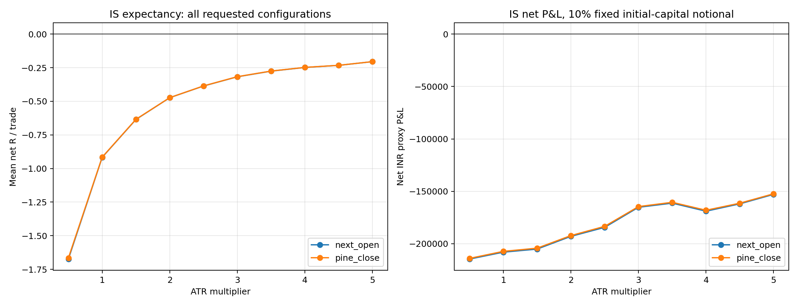
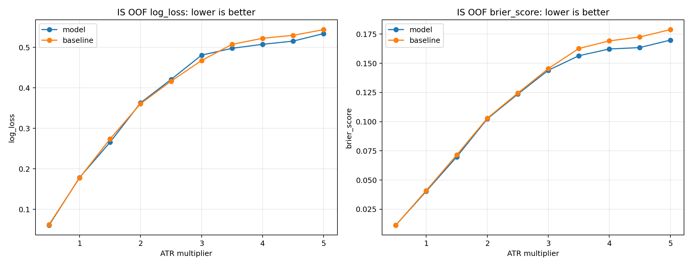
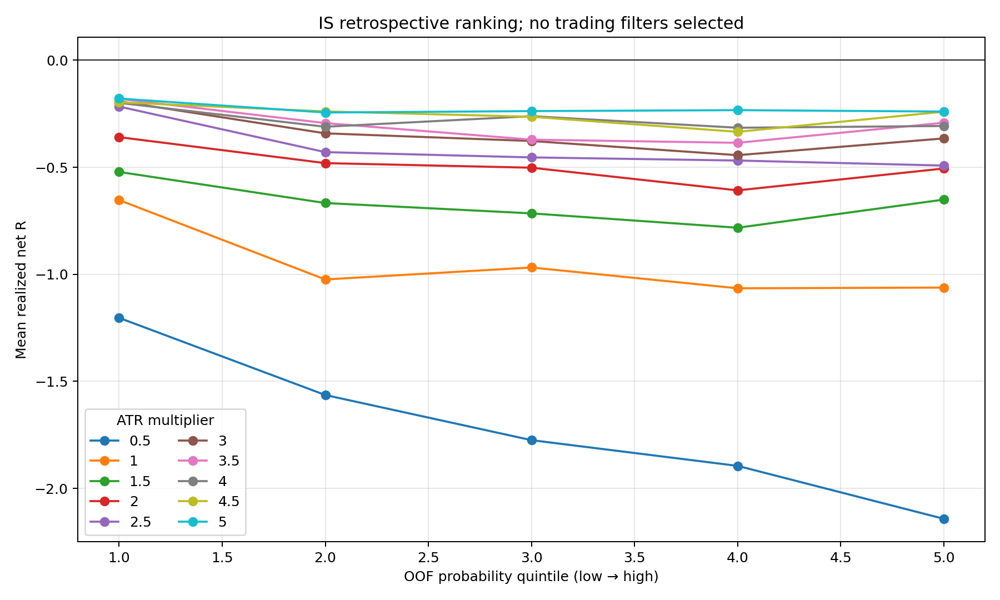

# NIFTY ORB + supplied Vervoort ATR: IS research

IS only, 2015–2021. Ten explicitly requested multipliers; ATR period 5 and OR target multiplier 1.5 fixed. No best configuration selected, no OOS outcomes evaluated, no probability trading filters. Existing files remain unchanged.

## Data and Pine recurrence

Processed 644,949 IS minute rows; 1698 complete regular sessions. Evening rows excluded in memory: 432. Zero volume unavailable, never used. Sessions with missing/duplicate/invalid minutes are rejected. Complete five-minute bars on rejected sessions still update indicators; incomplete bars do not. Missing whole days cannot be checked without a calendar.
Start-labeled five-minute candles aggregate exactly five unique IST minute starts: 09:15–09:19 → 09:15, 09:20–09:24 → 09:20, etc. OR uses 09:15,09:20,09:25 starts. First signal candle starts 09:30 and confirms at 09:35. Final eligible signal starts 14:50 and confirms at 14:55; the 14:55 candle is not an entry signal. Square-off occurs at the 14:55 candle close, 15:00.
ATR is Wilder RMA of true range, seeded with the first five completed-bar TR values. First TR uses high−low; later TR includes previous close, including overnight gaps. ATR/trail/trend continue across days and through regular candles after 15:00. No evening candles contribute. Before ATR initialization trail is NaN; each previous missing trail is nz(...,0). Trend starts at 0 and changes only under the supplied strict crossing conditions.
For closes above previous trail on consecutive bars, trail=max(previous trail,close−mult×ATR). For consecutive closes below, trail=min(previous trail,close+mult×ATR). Otherwise trail=close−loss if close>previous trail, else close+loss. Trend uses previous close and current close against the same previous stop, strictly; equality does not cross.

## Execution and parity limits

pine_close mode fills at signal close; next_open mode (primary) fills at the next five-minute open. Both include 5 bps fees per side and 1 bp adverse slippage per fill. Targets remain signal close ±1.5×OR width in both modes; actual entry-to-initial-stop R is recomputed. Target distance in R varies with the ATR stop and entry gap; this is not fixed 1.5R.
No entry-bar high/low from the completed signal candle can trigger a newly created close-fill bracket. Subsequent candles test the previously active stop before considering the current finalized ATR trail. Stops precede targets when both touched; stop gaps fill at open. Target fills receive no favorable gap improvement. If the next-open entry already exceeds its fixed target, a target-gap round trip exits at that open reference price and pays both slippage/fees. Stops invalid versus next reference open or adverse fill are rejected, logged, and consume the daily order attempt.
A surviving position updates its stop at each completed candle, only when trail remains on the proper side of close and only favorably; the update becomes active for the next candle. Existing stop/target orders remain active through 14:55–15:00; if neither triggers, square-off uses the 15:00 close. Exit timestamps for intrabar fills identify their containing candle, with conservative label-end at candle completion.
Pine parity here means supplied indicator/signal recurrence and signal-close entry timing. It does not claim exact TradingView broker-emulator transaction parity: requested conservative stop-first OHLC handling differs from TradingView historical price-path assumptions, and costs, next-open rejection and full-session exclusions are explicitly imposed. No TradingView export was provided for numerical cross-platform reconciliation. Official semantics: [TradingView strategies](https://www.tradingview.com/pine-script-docs/concepts/strategies/) and [Pine reference](https://www.tradingview.com/pine-script-reference/v6/#fun_ta.atr).

## Capital and metrics

Each configuration/mode starts INR 1,000,000; fractional proxy units = INR 100,000 / adverse entry fill (fixed 10% initial-capital allocation). No compounding sizing. Daily equity=capital+cumulative net P&L. Daily return=net P&L/prior observed regular-session equity; rejected/no-trade IS days are zero. Sharpe uses sample daily SD, sqrt(252), risk-free 0. Drawdown uses daily closing equity with initial capital included. Long/short metrics are independent hypothetical subledgers using the same dates/capital, with opposite-direction days flat. Index-price fills are not executable futures evidence.
Gross is reference-price P&L on the same realized path, units and actual risk denominator; adverse slippage and fees reconcile to net. Gross/net PF use currency; win rates and exit types differ. Average cost-to-risk averages per-trade (fees+slippage)/actual initial risk. Small initial risk can produce very large R/cost-to-risk; no outlier clipping or risk filter is introduced.

## Primary next-open comparison

| multiplier | mode | trades | long_trades | short_trades | gross_expectancy_points | net_expectancy_points | gross_expectancy_r | net_expectancy_r | gross_profit_factor | net_profit_factor | gross_win_rate | net_win_rate | target_rate | stop_rate | square_off_rate | total_net_pnl | maximum_drawdown_pct | maximum_drawdown_inr | daily_sharpe | average_initial_risk_points | average_cost_to_risk |
|---|---|---|---|---|---|---|---|---|---|---|---|---|---|---|---|---|---|---|---|---|---|
| 0.500000 | next_open | 1680 | 794 | 886 | -0.893539 | -13.852378 | -0.062878 | -1.673790 | 0.829267 | 0.107443 | 0.329167 | 0.101786 | 0.011905 | 0.986310 | 0.001786 | -214678.406388 | 0.214678 | 214678.406388 | -13.665850 | 9.659121 | 1.610912 |
| 1.000000 | next_open | 1678 | 806 | 872 | -0.533222 | -13.494099 | -0.030373 | -0.916771 | 0.943066 | 0.224455 | 0.370083 | 0.167461 | 0.045292 | 0.947557 | 0.007151 | -208077.086644 | 0.208077 | 208077.086644 | -8.536703 | 17.817222 | 0.886399 |
| 1.500000 | next_open | 1676 | 810 | 866 | -0.482551 | -13.445099 | -0.007304 | -0.634989 | 0.972963 | 0.297053 | 0.383652 | 0.208831 | 0.082936 | 0.906921 | 0.010143 | -205132.674257 | 0.205385 | 205449.608740 | -7.006027 | 25.423968 | 0.627685 |
| 2.000000 | next_open | 1674 | 820 | 854 | 0.239370 | -12.721032 | 0.023486 | -0.473021 | 1.046181 | 0.377350 | 0.394265 | 0.244325 | 0.122461 | 0.854241 | 0.023297 | -193002.753834 | 0.193592 | 193713.499193 | -5.611621 | 32.382846 | 0.496507 |
| 2.500000 | next_open | 1672 | 831 | 841 | 0.639752 | -12.324934 | 0.028776 | -0.386146 | 1.083499 | 0.439436 | 0.400718 | 0.269139 | 0.154904 | 0.804426 | 0.040670 | -184407.611859 | 0.185046 | 185161.786804 | -4.656683 | 39.157835 | 0.414922 |
| 3.000000 | next_open | 1664 | 839 | 825 | 1.695453 | -11.267974 | 0.033602 | -0.317560 | 1.162920 | 0.515830 | 0.408654 | 0.300481 | 0.186298 | 0.730168 | 0.083534 | -165263.280598 | 0.166887 | 167047.911909 | -3.665561 | 46.076567 | 0.351162 |
| 3.500000 | next_open | 1646 | 832 | 814 | 1.834413 | -11.122417 | 0.031351 | -0.275613 | 1.156773 | 0.545802 | 0.422843 | 0.320778 | 0.213852 | 0.648846 | 0.137303 | -161294.768542 | 0.162430 | 162650.606481 | -3.432716 | 52.775855 | 0.306964 |
| 4.000000 | next_open | 1629 | 813 | 816 | 1.125750 | -11.830876 | 0.024467 | -0.248091 | 1.106062 | 0.541615 | 0.442603 | 0.343155 | 0.225905 | 0.583794 | 0.190301 | -168982.392738 | 0.170320 | 170594.512847 | -3.524718 | 59.670182 | 0.272558 |
| 4.500000 | next_open | 1614 | 813 | 801 | 1.400309 | -11.554349 | 0.014107 | -0.232493 | 1.125855 | 0.559558 | 0.451053 | 0.358116 | 0.229864 | 0.514250 | 0.255886 | -161962.434616 | 0.163380 | 163657.036248 | -3.336764 | 66.066180 | 0.246600 |
| 5.000000 | next_open | 1591 | 800 | 791 | 1.942224 | -10.992018 | 0.019436 | -0.204997 | 1.149446 | 0.580159 | 0.471402 | 0.379635 | 0.240729 | 0.450660 | 0.308611 | -152936.337850 | 0.154032 | 154228.465908 | -3.085867 | 72.436458 | 0.224433 |

Pine-close mode metrics are separately in atr_multiplier_comparison.csv and distinct ledgers. Long/short metrics for both modes are in long_short_breakdown.csv. Daily accounts and ledgers are retained for every configuration.

## ML protocol

One classifier per multiplier, labeled from its primary next-open backtest, not original ORB/V1 targets. Original seven current-session prediction-time feature definitions are adapted to five-minute confirmation (including clock +5 minutes); historical missing features remain excluded. Added signal-time ATR points/price, trail distance/ATR, signal-close initial risk/price, and stored ATR trend state. All are computed at confirmation; no actual entry fill/risk, future trail, realized R, target_hit or exit enters X.
StandardScaler + LogisticRegression(C=1,class_weight=None), default regularization/solver, fixed max_iter=1000 and seed. Scaling and estimator fit only each training fold. Trail-distance/ATR is deterministically rounded to 12 decimal places to prevent scaling floating-point cancellation noise in mathematically constant features; no outcome-based feature selection. Five shared chronological calendar-date test windows, constructed once from observed IS regular dates, ensure common evaluation periods despite different eligible event sets. Latest label-end must precede test-window midnight. Nonoverlapping intraday labels need no additional embargo. Class counts and skipped-fold status are saved; all scored outcomes stay IS-only.

Invalid initial-stop rejection uses the eventual entry fill and restricts the supervised dataset to executed trades. This is an execution-dependent sample selection limitation, not a prediction-time feature. Initial indicator state starts at the available IS history (January 2015), with no unavailable prehistory inferred.

| fold | train_end | test_start | test_end |
|---|---|---|---|
| 1 | 2016-03-14 | 2016-03-15 | 2017-05-15 |
| 2 | 2017-05-15 | 2017-05-16 | 2018-07-06 |
| 3 | 2018-07-06 | 2018-07-09 | 2019-09-09 |
| 4 | 2019-09-09 | 2019-09-11 | 2020-11-03 |
| 5 | 2020-11-03 | 2020-11-04 | 2021-12-31 |

| multiplier | n | positive_prevalence | roc_auc | pr_auc_average_precision | log_loss | brier_score | balanced_accuracy_threshold_0_5 | baseline_log_loss | baseline_brier |
|---|---|---|---|---|---|---|---|---|---|
| 0.5 | 1406 | 0.011380 | 0.685971 | 0.030721 | 0.060707 | 0.011276 | 0.500000 | 0.062510 | 0.011257 |
| 1.0 | 1404 | 0.042735 | 0.681349 | 0.085573 | 0.178356 | 0.040369 | 0.500000 | 0.177640 | 0.041014 |
| 1.5 | 1402 | 0.077033 | 0.687897 | 0.160358 | 0.265707 | 0.069881 | 0.498454 | 0.273809 | 0.071498 |
| 2.0 | 1400 | 0.115714 | 0.643925 | 0.181986 | 0.362912 | 0.102388 | 0.501067 | 0.360795 | 0.102908 |
| 2.5 | 1400 | 0.143571 | 0.622837 | 0.202110 | 0.420800 | 0.123593 | 0.504127 | 0.416408 | 0.124433 |
| 3.0 | 1393 | 0.173008 | 0.611738 | 0.230430 | 0.480676 | 0.144005 | 0.503186 | 0.467489 | 0.145408 |
| 3.5 | 1376 | 0.201308 | 0.641755 | 0.297552 | 0.497519 | 0.156444 | 0.506281 | 0.507323 | 0.162647 |
| 4.0 | 1361 | 0.211609 | 0.648681 | 0.302934 | 0.507411 | 0.162257 | 0.501691 | 0.522283 | 0.169197 |
| 4.5 | 1346 | 0.219168 | 0.658640 | 0.339706 | 0.515252 | 0.163465 | 0.512459 | 0.529582 | 0.172545 |
| 5.0 | 1326 | 0.230769 | 0.661781 | 0.347944 | 0.533894 | 0.169856 | 0.516993 | 0.543623 | 0.178840 |

Primary PR-AUC is average precision; trapezoidal PR area is separately recorded. Each constant baseline uses training prevalence. Calibration deciles and probability quintiles are configuration-specific OOF bins, with boundaries/counts retained. Quintiles summarize gross/net R retrospectively; they do not select trading thresholds or claim executable profitability. Same calendar windows are not identical trade populations; configuration changes both qualifying trades and labels.

## Multiple testing and conclusions

Ten requested configurations and many probability bins were examined. All are reported; no maximum selected as a validated edge. Reported performance and model comparisons are descriptive point estimates, without multiplicity-adjusted hypothesis testing. A future inferential claim would require predeclared tests, dependence-aware uncertainty and familywise/FDR control; that has not been performed. IS results cannot establish out-of-sample or futures profitability.
Primary net expectancy is positive for 0 of ten configurations; baseline log loss is beaten by 6 classifiers. These counts are descriptive, not evidence from independent tests.

## Reproduction and checks

`python -m unittest discover -s orb_vervoort_atr_research -p "test_*.py" -v`, then `python orb_vervoort_atr_research/experiment.py`. Input checksum and reconciliation results are saved. Tests cover boundary alignment, Wilder initialization, Vervoort recurrence/trend/equality, next-open versus close fills, gap rejection, stop-first collisions, trailing-stop timing, square-off and future-data invariance. Saved results reconcile points, currency, R, direction counts, exit rates, daily account equity, feature/label alignment and folds. No external platform export means cross-platform numerical parity remains unverified.

## Saved charts

